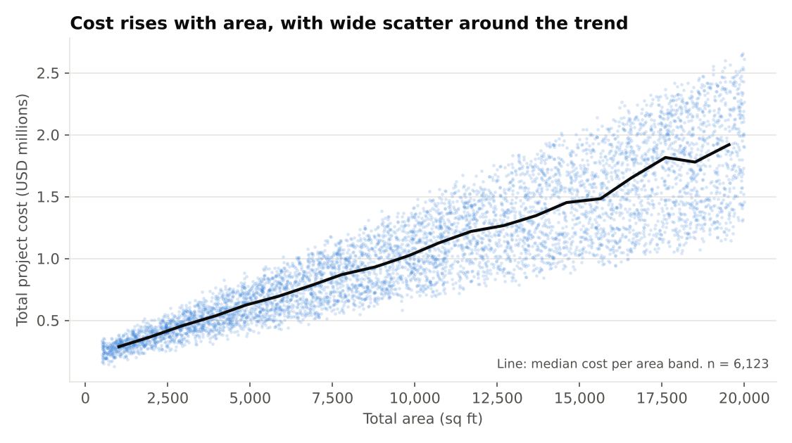
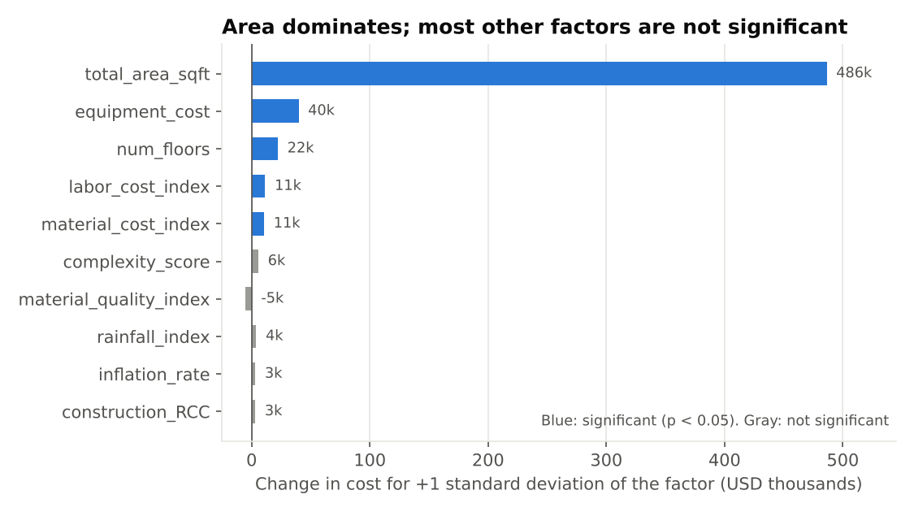

# What drives construction cost?

**Multiple regression on 6,123 construction projects** | Laura Camila Guayacan Ardila, civil engineer (cost estimation and quantity surveying)

**Question:** which project factors explain total cost, and how reliably can a model predict it?

## Result in four lines
- **Area dominates.** In the log-log model, +1% area is associated with about +0.66% cost (economies of scale).
- **Few other factors matter:** equipment cost, floors, labor index and material index. Weather and risk do not.
- **Fit:** R-squared 0.81 (linear) and 0.87 (log-log); hold-out R-squared 0.80 and 0.86.
- **Checked against Python `statsmodels`:** all 23 coefficients match to 4 decimals.

| | Linear | Log-log |
|---|---|---|
| R-squared | 0.81 | 0.87 |
| Hold-out MAPE (USD) | 16.5% | 18.2% |
| Max VIF | 1.35 | 1.35 |

**Files:** [Workbook (Google Sheets, view only)](LINK_TO_SHEET)

Method

- Ordinary least squares, two models: linear (USD) and log-log (area elasticity).
- Dummy variables with reference levels Commercial, Rural, Hybrid, Pile.
- Diagnostics: t and F tests, adjusted R-squared, VIF (multicollinearity), Breusch-Pagan (heteroscedasticity, present in both models and much smaller in log-log).
- Validation: 70/30 hold-out split. The log-log model back-transforms with a smearing factor.
- Excluded `cost_category` because it is derived from cost (leakage).

Data and limitations

- Kaggle "Deep Learning Building Cost Dataset" (colabsss, CC0), 6,123 rows, 21 columns. It appears synthetic (nearly independent predictors), so results show method, not real market behaviour.
- `equipment_cost` is probably a cost component rather than a driver (see the [SQL case study](../sql-outliers/)).
- No actual-versus-planned costs. Correlation, not causation.

