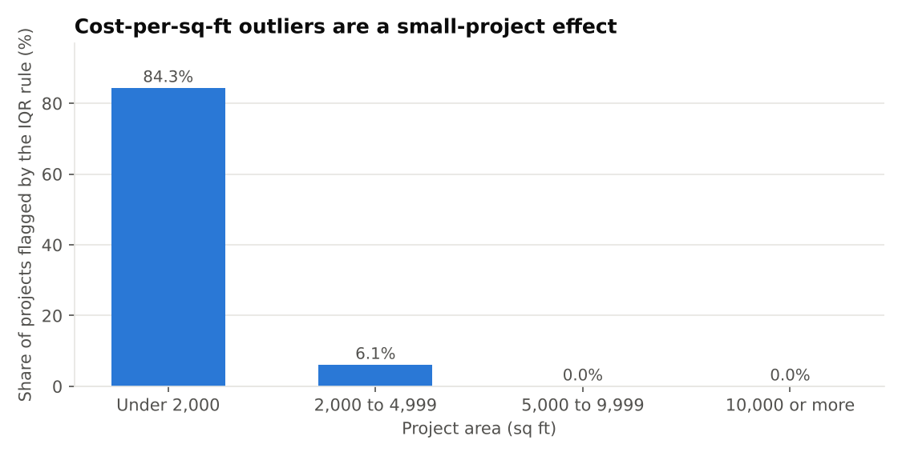
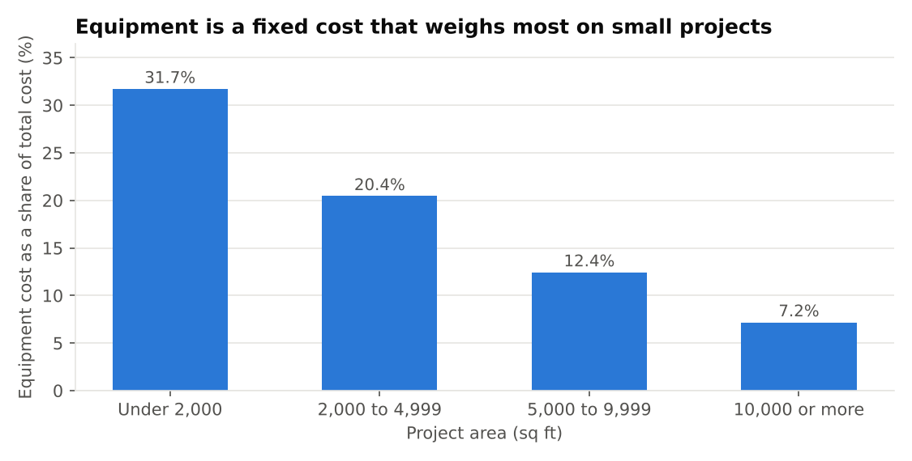

# Where do cost outliers come from?

**SQL analysis in BigQuery** | Laura Camila Guayacan Ardila, civil engineer (cost estimation and quantity surveying)

**Question:** which projects look unusually expensive per square foot, and why? Same 6,123-project dataset as the [regression case study](../cost-drivers/).

## Result in four lines
- **Not project type.** Share flagged: Residential 7.4%, Commercial 6.8%, Industrial 6.5% (chi-square p about 0.56).
- **Size.** 84% of projects under 2,000 sq ft are flagged; above 5,000 sq ft, none.
- **Fixed cost.** Equipment cost is about 100,000 USD in every size band, so it is 32% of cost on small projects and 7% on large ones. Removing it cuts the outliers by half (423 to 205).
- **Not weather or risk.** Correlations with cost per sq ft are near zero (|r| below 0.05).

**Files:** [All SQL queries](queries.sql) (10 queries, commented)

**Cross-check:** the IQR fences and the 423 flagged projects match the Google Sheets workbook exactly (upper fence 194.85 USD per sq ft).

Takeaways

- The IQR rule applied to a ratio such as cost per sq ft mostly detects a scale effect, not anomalies. A fairer screen compares each project with others of similar size, or uses regression residuals.
- About half of the effect is explained by equipment cost. The rest is unexplained. A plausible but untested hypothesis: other fixed costs the dataset does not record (mobilization, permits, design).

Limitations

Synthetic data; no actual-versus-planned costs; outliers are flagged and documented, not removed. The lack of weather and risk effects says nothing about real projects.

